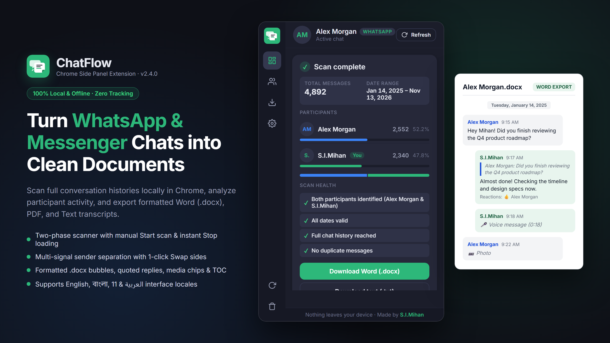
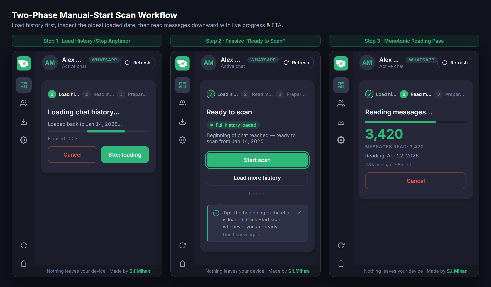
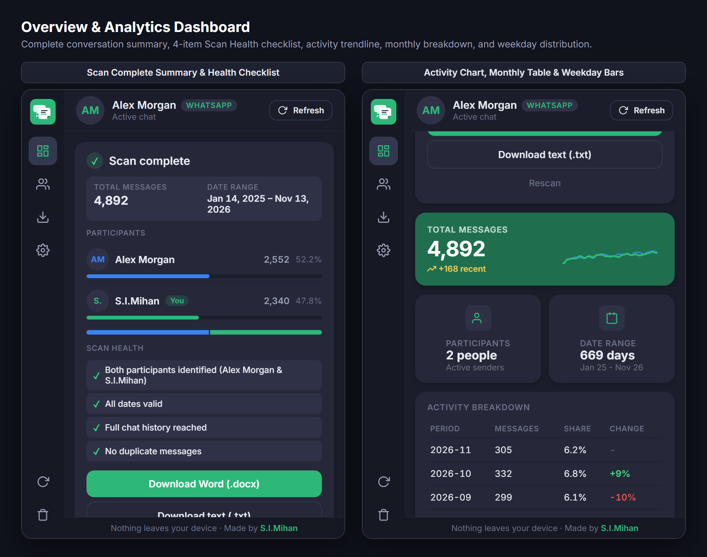
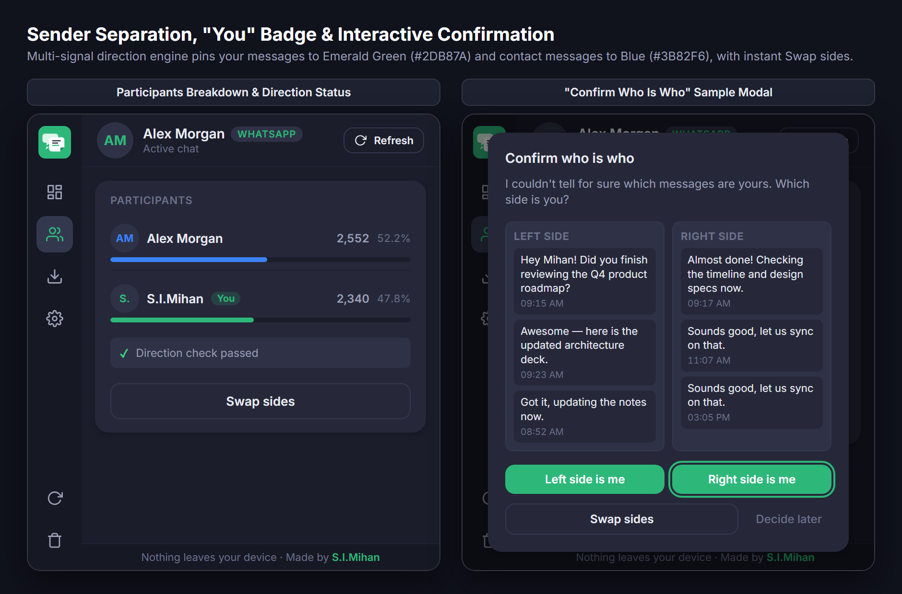
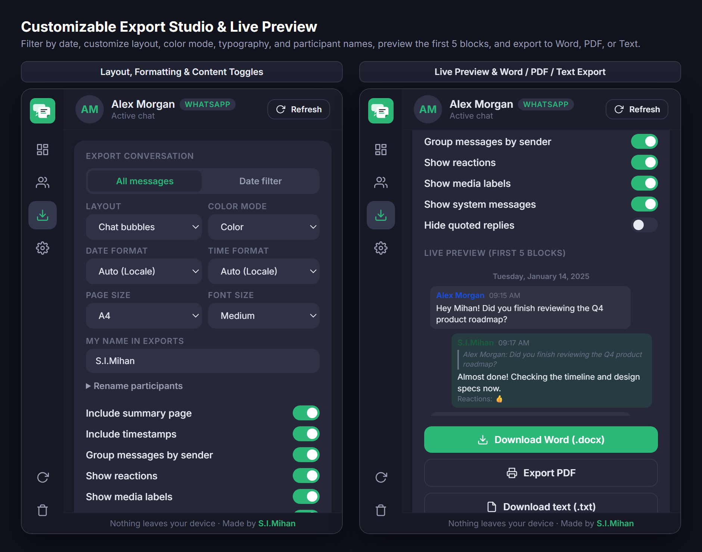
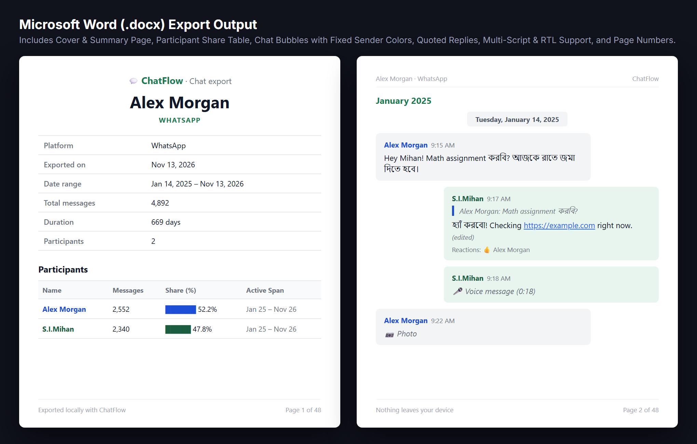

# ChatFlow — Chat to Document


> **Scan WhatsApp Web and Facebook Messenger conversations directly in Chrome and export them as formatted Microsoft Word (`.docx`), PDF, or Plain Text (`.txt`) documents — 100% offline and client-side.**

<p align="center">
  
</p>

---

## Table of Contents

- [Why ChatFlow?](#why-chatflow)
- [Key Features](#key-features)
- [Visual Walkthrough & Screenshots](#visual-walkthrough--screenshots)
- [Installation (Chrome / Edge / Brave)](#installation-chrome--edge--brave)
- [How to Use ChatFlow](#how-to-use-chatflow)
- [Export Formats & Customization](#export-formats--customization)
- [Troubleshooting & FAQ](#troubleshooting--faq)
- [Project Structure & Testing](#project-structure--testing)
- [Privacy & Credits](#privacy--credits)

---

## Why ChatFlow?

ChatFlow is a Chrome Side Panel extension built for professionals, researchers, legal documentation, and personal archiving. Instead of taking dozens of screenshots or copying raw unformatted text, ChatFlow scans your open conversation directly inside your browser and turns it into a clean, readable transcript with analytics — **without ever sending a single message to an external server**.

---

## Key Features

- **Multi-Platform Support**: Works seamlessly on **WhatsApp Web** (`web.whatsapp.com`), **Messenger Web** (`messenger.com`), and **Facebook Messages** (`facebook.com/messages`), with adaptive emerald-green and Messenger-blue themes.
- **Two-Phase Manual-Start Scan Engine**:
  - **Phase 1 (`Load history`)**: Scrolls upward to load older messages (and auto-triggers WhatsApp phone-sync banners), displaying the oldest loaded date and elapsed time. You can click **Stop loading** at any time to immediately pause at the loaded point.
  - **Passive `Ready to scan` State**: Shows whether **Full history** or **Partial history** is loaded, updates live if you scroll up manually in the chat, and lets you click **Start scan** when ready (or enable auto-start in Settings).
  - **Phase 2 (`Read messages`)**: Performs a single downward overlap-verified pass from the top with a monotonic `0–100%` progress bar, live message counter, speed (`msgs/s`), and ETA.
- **Multi-Signal Sender & Direction Separation**:
  - Combines DOM alignment, bubble geometry, delivery ticks, bubble background colors, and sender metadata (`content/direction.js`) to separate **your messages** (`#2DB87A` in UI / `#1B5E3F` in `.docx`) from **your contact's** (`#3B82F6` in UI / `#1D4ED8` in `.docx`).
  - Includes an interactive **"Confirm who is who"** sample modal and instant **Swap sides** buttons (in Participants & Settings) that update everything in memory **without rescanning**, plus per-chat preference saving.
- **Rich Document Exports (`.docx`, `.pdf`, `.txt`)**:
  - **3 Layouts**: *Chat bubbles*, *Compact transcript*, and *Plain text* (with automatic compact optimization for 20,000+ messages).
  - **Cover / Summary Page & Table of Contents**: Metadata table, participant share bars, and clickable monthly Table of Contents for conversations spanning more than 3 months.
  - **Full Conversation Fidelity**: Date dividers, 5-minute sender grouping, 3pt colored quoted replies, media chips (`📷 Photo`, `🎤 Voice message`, `🎥 Video`, `📄 File`, `[call]`), emoji reactions, `(edited)` markers, and page numbers (`Page X of Y`).
  - **Multi-Script & RTL Support**: Clean typography for Latin, Bengali (`বাংলা`), Arabic (`العربية` with `w:bidi`), Hindi (`हिन्दी`), and more — with `w:noProof` so Word won't clutter transcripts with red spellcheck squiggles.
- **Analytics Dashboard & Scan Health Checklist**:
  - **4-Item Scan Health Checklist**: Expandable checks for *Direction*, *Date validity*, *History completeness*, and *Duplicate merging*.
  - Dual-line activity SVG trendline, monthly breakdown table with month-over-month change percentages, and weekday distribution bar chart.
- **11 Interface Locales & Dark/Light Themes**: Supports `en`, `bn`, `es`, `pt_BR`, `fr`, `de`, `hi`, `ar`, `id`, `tr`, and `ru`, with instant Dark and Light mode switching.

---

## Visual Walkthrough & Screenshots

### 1. Two-Phase Scan Workflow
Load history first (stop anytime or scroll up manually), inspect the oldest loaded date on the passive **Ready to scan** screen, then run a clean downward reading pass.

<p align="center">
  
</p>

### 2. Overview & Analytics Dashboard
Inspect total message count, date span, participant share split, the 4-item **Scan Health** checklist, activity trendline, monthly table, and weekday chart.

<p align="center">
  
</p>

### 3. Participants Breakdown & "Confirm Who Is Who"
Verify message counts and percentages with a clear **You** badge, or use **Confirm who is who** / **Swap sides** to correct sender sides instantly without rescanning.

<p align="center">
  
</p>

### 4. Export Studio & Live Preview
Filter by date range, choose layout and formatting options, inspect the **Live preview (first 5 blocks)**, and download `.docx`, `.pdf`, or `.txt`.

<p align="center">
  
</p>

### 5. Generated Microsoft Word (`.docx`) Output
Every `.docx` export includes a styled summary cover page and clean, color-coded chat bubbles with quoted replies, media chips, reactions, and page footers.

<p align="center">
  
</p>

---

## Installation (Chrome / Edge / Brave)

Because ChatFlow runs completely locally as an unpacked Manifest V3 extension, installation takes less than a minute:

1. **Download or clone this repository**:
   ```bash
   git clone https://github.com/SharifulMihan/ChatFlow.git
   ```
   *(Or click **Code → Download ZIP** on GitHub and extract the folder to a permanent location on your computer.)*

2. **Open the Extensions page** in Google Chrome (or Edge / Brave):
   ```text
   chrome://extensions
   ```
3. Turn on **Developer mode** using the toggle switch in the top-right corner.
4. Click **Load unpacked** in the top-left corner.
5. Select the extracted **`ChatFlow`** folder (the folder containing `manifest.json`).
6. *(Optional)* Click the puzzle-piece Extensions icon in your browser toolbar and **Pin** ChatFlow for one-click access.

---

## How to Use ChatFlow

1. **Open a Conversation**
   - Go to [web.whatsapp.com](https://web.whatsapp.com), [messenger.com](https://www.messenger.com), or [facebook.com/messages](https://www.facebook.com/messages) and click any 1-on-1 or group chat.
2. **Open the ChatFlow Side Panel**
   - Click the **ChatFlow** icon in your toolbar. The top bar automatically detects the active conversation name and platform badge.
3. **Load History (Phase 1)**
   - Click **Scan this chat**. ChatFlow scrolls upward to load older messages and shows the oldest date loaded so far.
   - Want only recent months instead of years of history? Click **Stop loading** at any time to jump straight to **Ready to scan**.
   - On the **Ready to scan** screen, you can also scroll up manually in the chat window (the oldest date updates live) or click **Load more history**.
4. **Read Messages (Phase 2)**
   - Click **Start scan**. ChatFlow scrolls smoothly from the oldest loaded point down to the latest message while counting and deduplicating messages.
5. **Verify Participants (If Needed)**
   - Review the **Scan complete** card and **Participants** tab. If sides ever appear reversed, click **Swap sides** (or **Confirm who is who**) — your choice applies immediately and is remembered for that chat.
6. **Customize & Export**
   - Open the **Export** tab (or use the quick download buttons on the Overview card).
   - Optionally filter by **Start date / End date**, choose your **Layout**, **Color mode**, **Date/Time format**, **Page size**, **Font size**, rename participants, and preview the first 5 blocks live.
   - Click **Download Word (.docx)**, **Export PDF**, or **Download text (.txt)**. Files save directly to your browser's Downloads folder (`<Platform> Chat - <ChatName> - <YYYY-MM-DD>.docx`).

---

## Export Formats & Customization

| Option | Choices | Notes |
| --- | --- | --- |
| **Output Formats** | Word (`.docx`), PDF (Print), Plain Text (`.txt`) | Chunked `.docx` generation handles 50,000+ messages smoothly |
| **Layouts** | Chat bubbles, Compact transcript, Plain text | Auto-switches huge chats (>20,000 msgs) to Compact for fast opening |
| **Date Range** | All messages, Custom Date filter | Filter down to specific weeks, months, or days |
| **Color Mode** | Color, Black & White | Color mode pins you to `#1B5E3F` green and contact to `#1D4ED8` blue |
| **Page & Typography** | A4 / Letter, Small / Medium / Large font | Includes `w:noProof` & script-aware fonts (`Segoe UI`, `Nirmala UI`, `Noto Sans Arabic`) |
| **Content Toggles** | Summary page, Timestamps, Group by sender, Reactions, Media labels, System messages, Hide quoted replies | Live preview updates immediately as you toggle |

---

## Troubleshooting & FAQ

- **Long chat is taking a while to load older messages:**
  Click **Stop loading** during Phase 1 whenever enough history is loaded, then click **Start scan** on the **Ready to scan** screen. For WhatsApp Web, keeping your phone unlocked with WhatsApp open speeds up phone-sync history loading.
- **My messages and the contact's messages are swapped:**
  Go to the **Participants** tab (or **Settings**) and click **Swap sides**. ChatFlow updates every message and `.docx` bubble color in memory without needing to rescan, and remembers your preference for that chat.
- **"Lost connection to the chat page" error:**
  If the WhatsApp or Messenger tab was refreshed or put to sleep while scanning, click the **Reload tab** button inside ChatFlow's notice card (or press `F5` on the chat tab and click **Refresh**).
- **Platform DOM selectors changed after a WhatsApp/Messenger update:**
  ChatFlow isolates DOM queries in platform adapters under `content/adapters/`. You can inspect selector health anytime under **Settings → Selector Diagnostics → Run Check**, or update selectors in:
  - [`content/adapters/whatsapp.js`](content/adapters/whatsapp.js)
  - [`content/adapters/messenger.js`](content/adapters/messenger.js)
  - See [`ADAPTERS.md`](ADAPTERS.md) for architecture details and how to add support for new platforms.

---

## Project Structure & Testing

```text
ChatFlow/
├── manifest.json                 # Chrome Extension Manifest V3 configuration
├── background/
│   └── service-worker.js         # Side panel registration & session state relay
├── content/
│   ├── content-script.js         # Page message bridge & scan lifecycle handler
│   ├── scanner.js                # Two-phase scanner, overlap merging & AbortController
│   ├── direction.js              # Multi-signal direction & sender separation engine
│   ├── selectors.js              # Chat name sanitizer, date parsers & validation
│   └── adapters/
│       ├── base.js               # Base adapter interface
│       ├── whatsapp.js           # WhatsApp Web DOM & phone-sync adapter
│       ├── messenger.js          # Messenger / Facebook Messages DOM adapter
│       └── index.js              # Adapter registry
├── lib/
│   ├── transcript.js             # Filtering, grouping, media chips & shared colors
│   ├── exporter-docx.js          # Microsoft Word (.docx) builder
│   ├── exporter-pdf.js           # Print-to-PDF HTML generator
│   ├── exporter-txt.js           # Formatted Plain Text (.txt) exporter
│   └── vendor/docx.min.js        # Local docx library (zero external CDN requests)
├── sidepanel/
│   ├── index.html                # Side panel layout (Overview, Participants, Export, Settings)
│   ├── sidepanel.js              # Dashboard controller, charts, live preview & storage
│   ├── css/                      # Design tokens, components & layout stylesheets
│   └── fonts/                    # Bundled Inter font weights (.woff2)
├── _locales/                     # 11 localized UI bundles (en, bn, es, pt_BR, fr, de, hi, ar, id, tr, ru)
├── docs/screenshots/             # Screenshots used in this README
└── scratch/                      # Node.js verification & unit test suites
```

### Running Unit Tests

All core modules include standalone Node.js verification suites (requires Node.js 18+):

```bash
node scratch/test_all.js
node scratch/test_direction.js
node scratch/test_part1_to_4.js
```

---

## Privacy & Credits

- **100% Local & Private**: ChatFlow executes exclusively inside your browser. Zero cloud servers, zero external API calls, zero telemetry or analytics. Per-chat direction preferences store only participant display names and side flags in `chrome.storage.local` — never message text.
- **Developed by**: **S.I.Mihan** ([@SharifulMihan](https://github.com/SharifulMihan))
- **Built with**: Vanilla JavaScript (ES Modules), Chrome Side Panel API (Manifest V3), bundled Inter fonts, and local `docx` generation.
